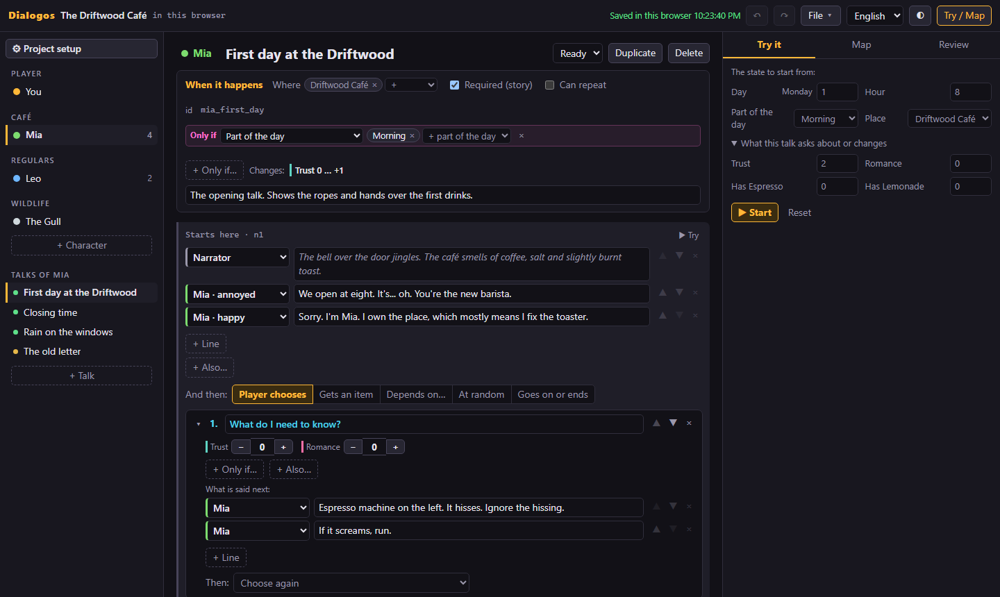

# Dialogos

A branching dialogue editor for games. Write your characters' talks in the browser; Dialogos
saves them as one plain JSON file that your game reads.



## What it does

- **Characters** with notes, moods, likes and dislikes, and how they see each other.
- **Your own stats**: trust, romance, friendship, money, reputation… per character or global,
  with limits and starting values.
- **Time and place**: days, parts of the day (morning, night…), hours, weekdays, places.
- **Items and flags**: what the player can have, give or show; on/off marks for the story.
- **Talks as trees of blocks**: player choices, branches by condition, random lines, waiting for
  an item (a gift, a drink, a piece of evidence), "choose again".
- **Conditions and effects** on all of the above, plus named events for your game to handle.
- **Try a talk on the spot** from any state you set, see its map, and get a review that catches
  broken links, missing references, dead ends and lines too long for your text box.
- Saves as you type, undo and redo, light and dark themes, English and Spanish.
- **Exports** the JSON project, and a CSV of every line for translators or voice actors.

## Run it

**Online:** [nethercap.github.io/dialogos](https://nethercap.github.io/dialogos/), or
[with the example open](https://nethercap.github.io/dialogos/?example). Your project stays in
your browser; nothing is uploaded.

**No install:** open `web/index.html` in your browser (or host this folder, for example on
GitHub Pages). The project is kept in the browser as you type. In Chrome and Edge,
*File → Save to a file…* writes straight to a file on disk; anywhere, *File → Download .json*.

**With Python 3** (standard library only), editing a file directly:

```sh
python dialogos.py path/to/dialogue.json
```

On Windows you can double-click `dialogos.bat`, or drop a `.json` file on it; on macOS and Linux,
`./dialogos.sh path/to/dialogue.json`. It opens the page, saves every change to the file, keeps
backups in `.dialogos_backups` next to it, and warns you if the file changes on disk.

*File → Open the example* loads [`examples/cafe.json`](examples/cafe.json), a small project
that uses every feature.

## Using the file in your game

- [`docs/FORMAT.md`](docs/FORMAT.md) describes the format: short, with every field and rule.
- [`schema/dialogos.schema.json`](schema/dialogos.schema.json) is the same as a JSON Schema.
- [`web/runtime.js`](web/runtime.js) is a small runner with no dependencies (browser or Node).
  Use it as it is, or read it when porting to your engine:

```js
const Dialogos = require('./web/runtime.js');
const state = Dialogos.newState(project);
const run = Dialogos.start(project, 'mia_intro', state);
for (let ev = run.next(); ev.type !== 'end'; ev = run.next()) {
  if (ev.type === 'line') show(ev.who, run.fill(ev.text));
  else if (ev.type === 'choice') run.choose(await pick(ev.options));
  else if (ev.type === 'give') run.give(await pickItem());   // or run.give(null)
}
```

## Tests

From this folder (Node 18 or newer):

```sh
node --test
```

## License

[MIT](LICENSE)
